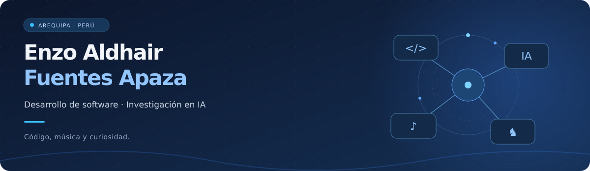
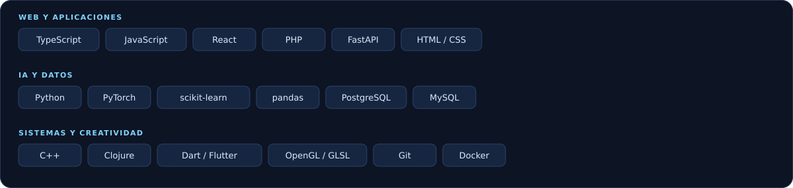

  

  <a href="https://enzoaldhairfuentesapaza.github.io/"><strong>Explora mi portafolio ↗</strong></a>
  &nbsp; · &nbsp;
  <a href="https://enzoaldhairfuentesapaza.github.io/assets/CV_Enzo_Fuentes_Profesional.pdf">Mi CV</a>
  &nbsp; · &nbsp;
  <a href="mailto:enzo.fuentes@ucsp.edu.pe">Conversemos</a>

### Hola, soy Enzo 👋

Estudio **Ciencia de la Computación en la Universidad Católica San Pablo**, en Arequipa, Perú. Trabajo con entornos web y disfruto adaptar soluciones a dominios específicos: entender cómo funciona una organización y construir herramientas que ayuden a automatizar sus procesos.

Soy autodidacta, me gusta asumir retos y aprendo investigando y construyendo. Combino el análisis lógico con la creatividad; al trabajar en equipo, procuro tomar la iniciativa, escuchar y facilitar acuerdos.

> Entender el problema también es parte de construir una buena solución.

### En qué estoy trabajando

- 📦 **Sistema de Almacenamiento Inteligente:** inventario, operaciones empresariales, estadísticas y una integración de IA en desarrollo.
- 🧠 **IA explicable:** experimentos con Grad-CAM y LIME en segmentación 3D de imágenes de resonancia magnética.
- 🌐 **Software para empresas:** catálogos, cotizaciones, paneles de administración y automatización de procesos.
- 🔎 También exploro sistemas distribuidos, bases de datos, computación gráfica y programación funcional.

### Mi caja de herramientas

  

**Lenguajes con los que he trabajado:** Python, C++, JavaScript, TypeScript, PHP, Dart, Clojure, SQL, GLSL, HTML y CSS. Durante mi formación también he utilizado C, R y ensamblador.

### Algunos proyectos que cuentan mi recorrido

| Proyecto | Qué exploro |
| :--- | :--- |
| 🚜 **[DH & DM Maquinarias](https://github.com/enzoaldhairfuentesapaza/DH-DM-Maquinarias-Web)** · [Web](https://www.dh-dm-maquinarias.com/) | Plataforma comercial con catálogos, cotizaciones y administración. **Web · Software empresarial · TypeScript · PHP · SQL** |
| 🧠 **[XAI en segmentación 3D](https://github.com/enzoaldhairfuentesapaza/Implementacion-de-metodos-post-hoc-de-interpretabilidad-en-la-segmentacion-3D-de-tumores-cerebrales)** | Comparación experimental de Grad-CAM y LIME sobre una 3D U-Net. **XAI · Deep Learning · Visión por computador · Python** |
| 📦 **[Sistema de Almacenamiento Inteligente](https://github.com/enzoaldhairfuentesapaza/Sistema-almacenamiento-inteligente)** | Gestión empresarial con inventario, sedes, roles y analítica. En desarrollo. **FastAPI · React · PostgreSQL · Python · TypeScript** |
| 🌐 **[DistributedNeuralNetUDP](https://github.com/enzoaldhairfuentesapaza/DistributedNeuralNetUDP)** | Entrenamiento distribuido de redes neuronales mediante UDP. **Sistemas distribuidos · Redes · Machine Learning · C++ · Python** |
| 🎸 **[LPGuitarHero](https://github.com/enzoaldhairfuentesapaza/LPGuitarHero)** | Juego rítmico multijugador con jugadores y espectadores. **Programación funcional · Videojuegos · Clojure · JavaScript** |
| 🪐 **[PlanetHunter AI](https://github.com/enzoaldhairfuentesapaza/PlanetHunter-AI)** | Exploración de datos astronómicos para detectar candidatos a exoplanetas. **Machine Learning · Ciencia de datos · Astronomía · Python** |

**[Ver todos los proyectos y sus detalles en mi portafolio →](https://enzoaldhairfuentesapaza.github.io/#proyectos)**

### Mi actividad en GitHub

  
  

Tarjetas actualizadas con GitHub Actions. La distribución de lenguajes representa el código que GitHub detecta en los repositorios; no es una medida del dominio de cada tecnología.

### También hay vida fuera del código

🎵 El **bajo** es mi instrumento principal; también disfruto la guitarra acústica y la batería.  
♟️ El **ajedrez** ha acompañado buena parte de mi vida.  
🎨 Me gusta **pintar, escribir** y encontrar otras formas de expresar ideas.  
🤝 Participo en el **liderazgo juvenil de mi iglesia** y valoro el servicio a mi comunidad.

Un poco más sobre mí

Soy líder de jóvenes de la DEPEC en la Iglesia Evangélica Peruana y en mi iglesia SEC Jorge Chávez. Formé parte de una banda de música latinoamericana y suelo tocar música cristiana juvenil en eventos.

La creatividad, la fe y la espontaneidad conviven con mi interés por razonar, investigar y resolver problemas.

*«Heme aquí, envíame a mí.» — Isaías 6:8*

---

  Desde Arequipa, Perú 🇵🇪 
  <a href="mailto:enzo.fuentes@ucsp.edu.pe">enzo.fuentes@ucsp.edu.pe</a> · Español nativo · Inglés intermedio

